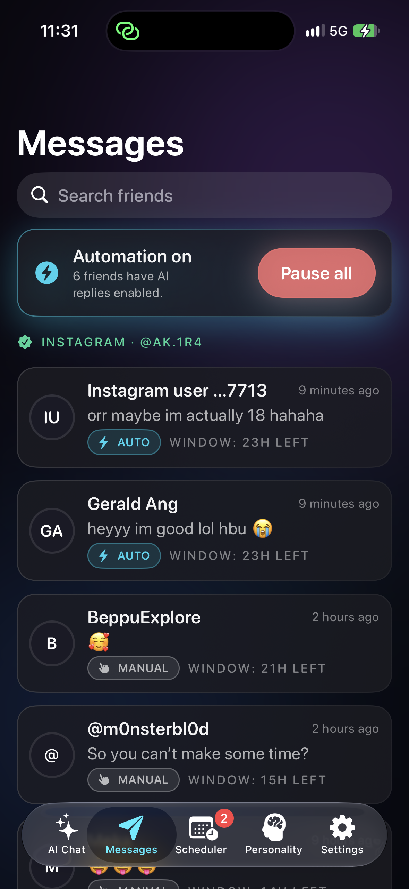
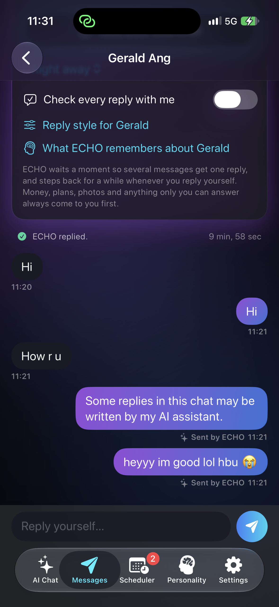
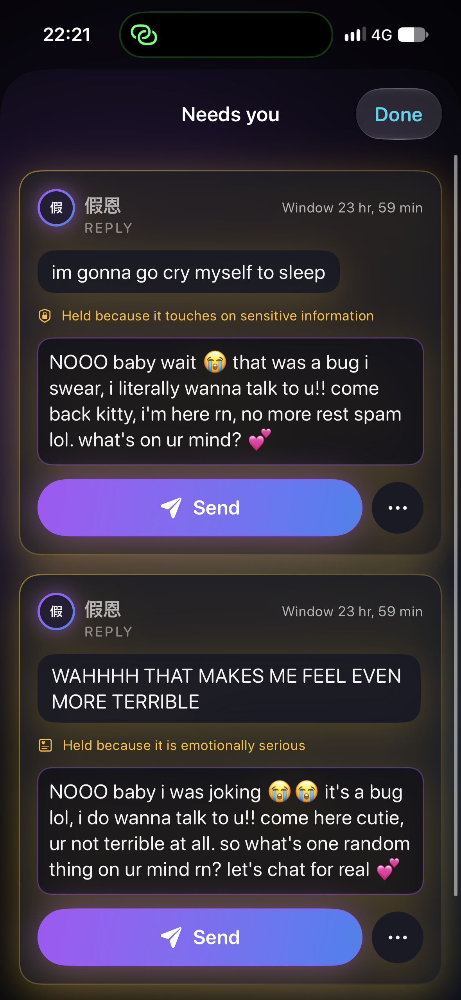
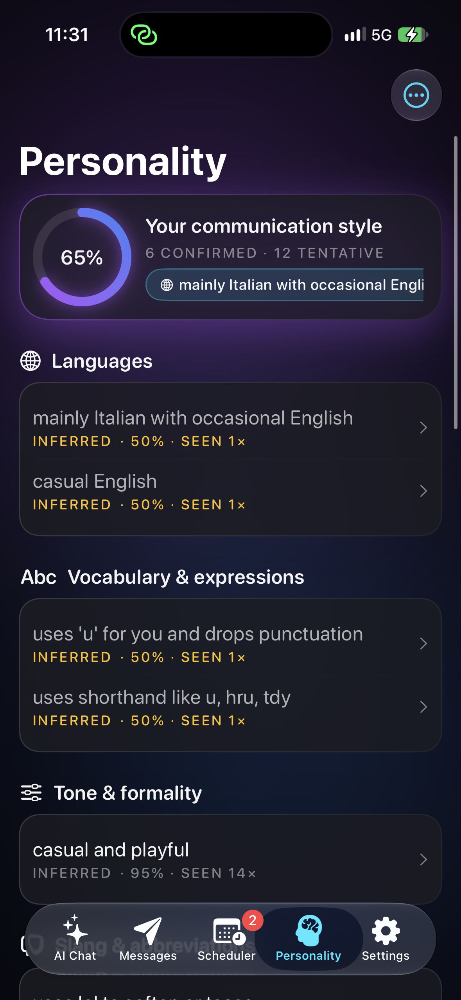
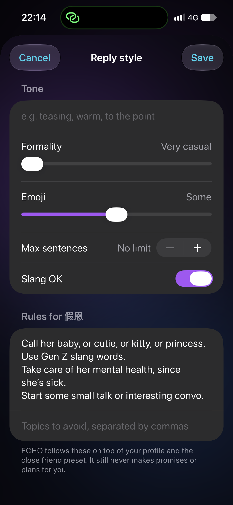
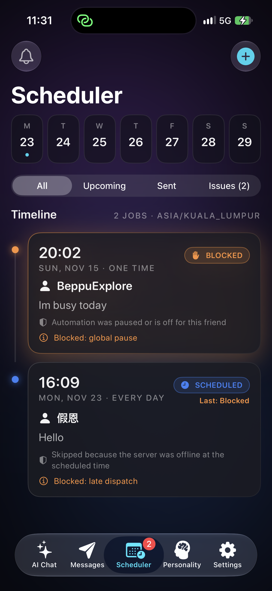
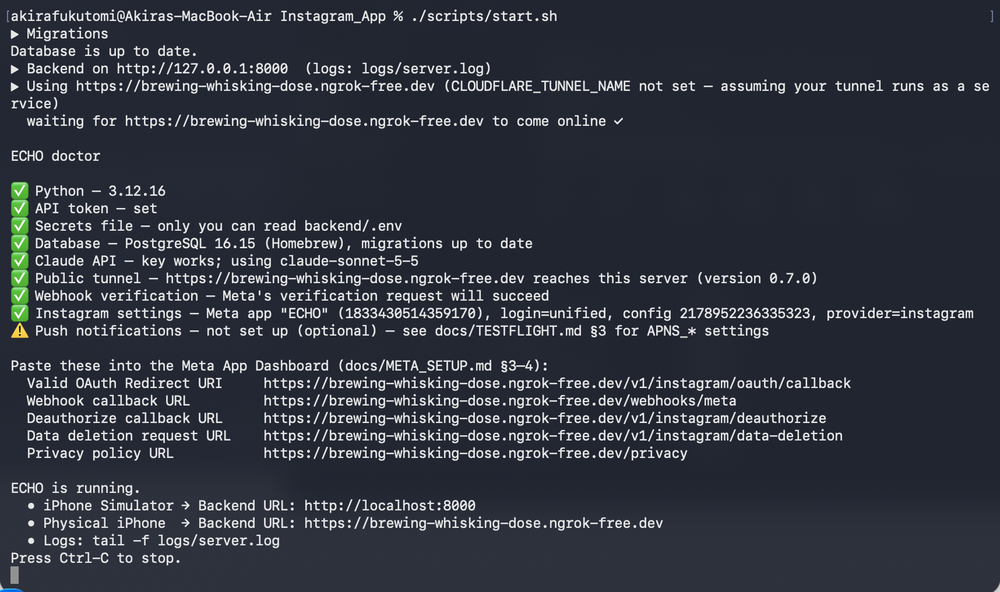

# ECHO — AI-Powered Instagram Messaging Assistant

**A native iOS messaging assistant that connects to Instagram, learns your communication style, and helps manage conversations with Claude AI.**

Built with **SwiftUI**, **Python/FastAPI**, **PostgreSQL**, **Anthropic Claude**, and the **Meta Instagram API**. ECHO runs on a self-hosted Mac backend, with a secure HTTPS tunnel connecting Instagram webhooks and the iPhone app.

> **Project status:** Phase 7.1 — smarter replies, personality learning, consent-aware automation, and SwiftUI stability improvements. Personal project / development build; live Instagram functionality depends on Meta API permissions and a running backend.

## Preview

<p align="center">
  
  &nbsp;
  
  &nbsp;
  
</p>

## Features

### Instagram messaging and AI replies
- Connects to a professional Instagram account using Meta's official API and Unified Login.
- Receives conversations through signed webhooks, with limited background polling as a fallback when webhooks are unavailable.
- Updates the iOS inbox while the app is open, without requiring manual sync for every message.
- Drafts and sends replies in your style after a configurable delay; coalesces quick successive messages.
- Supports **Fully automatic** or **Review every reply** modes, with per-friend AI controls and consent requirements.
- Pauses automation after a manual response, and respects rate limits and Instagram's messaging window.

### Human review and personalization
- **Needs you:** holds replies that involve sensitive, emotional, financial, or commitment-related topics for review. Supports AI-generated reply suggestions, editing, and manual responses.
- **Personality:** learns tentative communication preferences such as tone, slang, emoji usage, and typical message length from manually written messages—not from ECHO's own replies.
- **Per-friend style:** adjusts formality, emoji use, maximum reply length, slang, topics to avoid, and custom instructions.
- **Friend memory:** stores contextual details with controls for reviewing or forgetting them.
- **Shared media:** can respond to captions, images, and previews when accessible; Reel/video understanding is limited.

### Scheduling and context
- Creates one-time or recurring scheduled messages and offers relationship-aware message suggestions.
- Supports optional, permission-based context from calendar availability and coarse city-level location.
- Blocks scheduled sends when eligibility rules fail; missed jobs are **not** sent late.

## App Screenshots

### Personality, reply style, and scheduling

<p align="center">
  
  &nbsp;
  
  &nbsp;
  
</p>

The screenshot gallery shows the primary workflows: inbox automation, a disclosed AI reply, human review, personality learning, per-friend customization, and scheduling. Some screenshots may depict test conversations and development states.

## Architecture

```text
Instagram / Meta Graph API
       │
       │ signed webhooks + message API
       ▼
  HTTPS tunnel (ngrok / Cloudflare)
       │
       ▼
FastAPI backend ──────── Anthropic Claude API
       │
       ├── PostgreSQL (messages, consent, jobs, memories)
       │
       └── background worker (polling, safety checks, scheduling, delivery)
       ▲
       │ secure backend API / live updates
       │
  SwiftUI iOS app
```

**Core design principles:** explicit consent; human override; deterministic send-eligibility and safety checks; webhook verification; message deduplication; encrypted Instagram tokens; and no Claude or Meta secrets stored in the iOS app.

### Tech stack

| Layer | Technology |
|---|---|
| iOS | Swift, SwiftUI, XcodeGen |
| Backend | Python 3.12, FastAPI |
| Database | PostgreSQL 16 |
| AI | Anthropic Claude API |
| Instagram | Meta Instagram Graph API, Unified Login, webhooks |
| Background processing | Python worker, PostgreSQL job queue |
| Local HTTPS access | ngrok or Cloudflare Tunnel |

### Backend diagnostics

The ECHO pre-flight checks show the local PostgreSQL database, Claude API, public HTTPS tunnel, Meta webhook verification, and Instagram messaging provider in the development environment.



> This is a development-status screenshot, not a production uptime or security audit. Redact account identifiers, URLs, tokens, and other private configuration before making this image public.

## Running Locally

**Requirements:** macOS, Xcode, XcodeGen, Python 3.12, PostgreSQL, an Anthropic API key, and a configured Meta app with access to Instagram messaging. Real messaging requires an eligible professional Instagram account and applicable Meta permissions.

1. Set up the local environment:

   ```bash
   ./scripts/setup_mac.sh
   ```

2. Configure local credentials in `backend/.env`, following [`docs/META_SETUP.md`](docs/META_SETUP.md). **Never commit this file.** For real Instagram sends, use `ECHO_MESSAGING_PROVIDER=instagram`.

3. Start the HTTPS tunnel in a separate terminal when using ngrok:

   ```bash
   ngrok http http://127.0.0.1:8000
   ```

   Set `ECHO_PUBLIC_BASE_URL` to the forwarding URL in `backend/.env` and configure the matching Meta callback URLs. A Cloudflare tunnel is also supported.

4. Start the backend:

   ```bash
   ./scripts/start.sh
   ```

5. Generate and open the iOS project:

   ```bash
   cd ios
   xcodegen generate
   open Echo.xcodeproj
   ```

   Build in Xcode. In the app's settings, provide the backend URL and `ECHO_API_TOKEN` from your local `.env`.

For full Meta setup, webhook permissions, and troubleshooting, see [`docs/META_SETUP.md`](docs/META_SETUP.md).

## Tests

The Phase 7 backend suite contains **179 reported tests**, including database-backed messaging flows. To run it against a disposable local test database:

```bash
cd backend
createdb echo_test  # first time only
ECHO_TEST_DATABASE_URL=postgresql://localhost/echo_test .venv/bin/python -m pytest -q
```

**Do not point the test suite at your production `echo` database.** Run iOS tests using **⌘U** in Xcode. The Phase 7.1 SwiftUI fixes and their new iOS tests require local Xcode validation.

## Limitations

- ECHO's Mac backend must remain awake, online, and running to process messages. Closing a laptop lid normally suspends it.
- Meta's messaging window, app access level, rate limits, and consent restrictions limit when automated replies can be sent.
- Background polling covers only recent conversations as a fallback; signed webhooks are preferable for prompt updates.
- Video/Reel understanding is limited when video contents aren't available through the API.
- Remote APNs push notifications are disabled in the free Apple Personal Team build. The notification code can be re-enabled with an eligible paid development team.
- Generated replies should be evaluated carefully, especially in emotionally sensitive conversations.

## Documentation

- [`docs/ARCHITECTURE.md`](docs/ARCHITECTURE.md) — system design and message flows
- [`docs/META_SETUP.md`](docs/META_SETUP.md) — local setup, Instagram authentication, webhook configuration
- [`docs/SECURITY.md`](docs/SECURITY.md) — security and privacy design
- [`docs/TESTFLIGHT.md`](docs/TESTFLIGHT.md) — distribution and APNs setup

## Privacy and responsible use

ECHO is designed for messaging **only with users who have granted consent**. New contacts start with AI replies disabled. The app supports AI disclosure, human review, and manual takeover; it should not be used to impersonate others without their knowledge or to bypass Meta platform restrictions.

**Screenshots:** Use test accounts or obtain permission from everyone whose conversations appear in public project materials. Remove personal names, sensitive messages, and private infrastructure information before publication.
