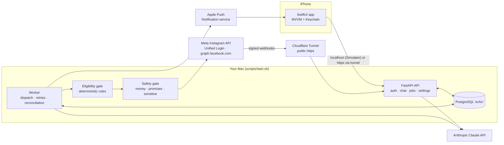

# ECHO — Architecture Overview

*Updated for Phase 4 (local Mac deployment) · November 2026 · Owner timezone: Asia/Kuala_Lumpur*

## 1. The short version

ECHO has three parts:

1. **iOS app** (SwiftUI, MVVM, iOS 17+). It shows the UI and keeps a small encrypted local cache. It holds **no** Claude API key, Meta secrets or long-lived Instagram tokens.
2. **Backend** (FastAPI, Python 3.12) running **on your Mac**, reachable from the internet only through a **Cloudflare Tunnel**. It owns every secret. It calls Claude and Meta, verifies webhooks, and enforces the messaging rules.
3. **Worker + PostgreSQL** (local PostgreSQL database `echo`). The database holds the jobs. A worker inside the same process claims due work, runs deterministic eligibility checks, sends, retries and reconciles. It runs whenever the Mac is awake and `scripts/start.sh` is running, independent of the phone.

The language model writes text. It never decides whether a message is *allowed* to be sent. That decision comes from plain backend code (`app/domain/messaging_window.py`), which has unit tests.



## 2. Components

### iOS app (`ios/Echo`)

| Layer | Folder | Responsibility |
|---|---|---|
| App | `App/` | Composition root (`AppModel`), tab navigation, app entry |
| Design system | `DesignSystem/` | Colour, type, spacing tokens; glass cards, neon buttons, status pills, animated background, typing indicator, haptics |
| Models | `Models/` | Plain `Codable` value types that mirror backend tables |
| Services | `Services/` | Protocols plus mock and real implementations: `ChatService` (Mock/Backend), `ProfileRepository` (Local/Remote) behind `ProfileStore`, `APIClient`, `KeychainStore`, `MessagingStore`, `LocalJSONStore` |
| Features | `Features/<Tab>/` | One folder per tab: View + ViewModel (`@Observable`, `@MainActor`) |

**Mock-first rule.** Each service sits behind a protocol or a store with the API it will keep later. `AppModel` picks the implementation from Settings: **mock** (offline, on-device) or **backend** (URL + Keychain token). Switching rebuilds the services and leaves the views alone. Messages and Scheduler still use `MessagingStore.mock()` until Phases 3–4.

**Accessibility.** All type uses Dynamic Type text styles. Every animation checks Reduce Motion. Status always pairs colour with an icon and a word. Interactive elements have VoiceOver labels.

### Backend (`backend/app`)

| Module | Responsibility |
|---|---|
| `api/` | HTTP routes: `/health`, `/v1/chat/messages` (POST/GET/DELETE), `/v1/profile` (+ `/traits`, `/examples`, `/export`), `/webhooks/meta` |
| `core/` | Settings (env vars only), JSON logging, auth |
| `ai/` | `AIProvider` protocol; `AnthropicProvider` (Claude) and `MockAIProvider`; prompts; context builder |
| `services/` | `chat_service.run_turn` (one chat turn end to end) and `maybe_summarize` |
| `db/` | psycopg 3 async pool + plain-SQL repositories |
| `domain/` | Pure business rules: memory merge (`memory.py`), messaging-window eligibility, job state machine, backoff |
| `integrations/meta/` | Webhook signature verification now; Graph API client in Phase 4 |
| `worker/` *(Phase 3)* | Claims due `job_runs` and `webhook_events`, then generates, gates, sends and notifies |

**Auth.** ECHO has one owner, so the backend uses a single long random bearer token (`ECHO_API_TOKEN`), stored in the iOS Keychain and compared in constant time. Sign in with Apple JWTs only become worthwhile if ECHO serves more than one person. That would mean swapping the `require_user` dependency, so it's deferred to Phase 6 as optional hardening.

## 3. Key flows

### 3.1 Personality learning (Feature 1) — implemented in Phase 2

1. **You send a message.** The app posts `{client_msg_id, text}`. The id is the message's own UUID, so a retry after a dropped connection returns the stored reply instead of creating a duplicate.
   - A unique constraint allows exactly one assistant reply per user message (`chat_messages.in_reply_to`).
   - If Claude fails, the user message stays stored and the app shows **Tap to retry**.
2. **The backend builds a compact context.** It never sends the full history. The context contains:
   - up to 40 profile traits (your edits and stated facts first, then inferences by confidence), each with its stable key
   - the keys of traits you deleted
   - the latest rolling summary
   - the last 12 messages
   - up to 4 approved writing examples (matching your current language first)
   - the current time in Asia/Kuala_Lumpur

   Stored text is escaped so it can't break the prompt's tags.
3. **Claude call** (`claude-sonnet-5-5`):
   - `output_config.format` (JSON schema) returns `{reply, language, memory_updates[]}`.
   - `output_config.effort = medium` and `thinking: between_tools` keep latency low.
   - The static system prompt (about 900 tokens) carries `cache_control`, so later turns read it from cache.
   - No temperature (Sonnet 5.5 rejects it).
   - Refusals, truncation, malformed JSON, rate limits and outages each map to a clear error for the app.
4. **Deterministic sanitising** (`domain/memory.py`) runs before anything is stored:
   - enums are normalised, and keys are forced to `category.name` form
   - at most 6 updates per turn
   - e-mails, phone/card/ID numbers and passwords are dropped
   - rejected keys are ignored
5. **Merge rules** (the same on server and device, tested on both):
   - **Stated facts** → confidence 1.0.
   - **Observations** start at most at 0.6. Each repeat closes 25% of the gap to certainty, capped at 0.95, so they stay tentative.
   - **Your edits** always win.
   - **Deleted traits** keep a tombstone and are never re-learned.
   - **"I'm not into X anymore"** archives the trait. It can be learned again later.
6. **One transaction** stores the reply, the merged traits and an audit entry. Traits are row-locked, so concurrent turns can't lose evidence.
7. **Rolling summary.** Once 28 messages have built up since the last summary, a background task folds all but the newest 12 into it using `claude-haiku-5-5`. An advisory lock makes sure only one summary runs at a time.

### 3.2 Automatic reply to an incoming DM (Feature 3)

```
Meta webhook ─▶ verify X-Hub-Signature-256 ─▶ INSERT webhook_events (event_key UNIQUE) ─▶ 200 OK fast
                                                         │
Worker claims event ─▶ ignore echoes of our own sends (loop guard)
  ─▶ upsert ig_messages, set friends.last_inbound_message_at
  ─▶ ELIGIBILITY GATE (deterministic): global pause? friend AI on? manual takeover?
                                        consent granted? inside 24h window (−5 min margin)?
        └─ fail ─▶ no send; optional draft + notification
  ─▶ build context (profile + friend profile + friend memory + recent thread)
  ─▶ Claude drafts reply + classifies: money / commitment / sensitive / unknown info / emotional
  ─▶ SAFETY GATE: any flag ─▶ review_items (needs_attention) + push; stop
  ─▶ INSERT outbound_messages (reply_to_inbound_id UNIQUE → max one auto reply per inbound)
  ─▶ re-check eligibility ─▶ POST graph.facebook.com/<version>/<IG_ID>/messages
  ─▶ mark sent / retry with backoff / unknown → reconcile ─▶ audit_log + notification_outbox
```

### 3.3 Scheduled message (Feature 4)

- `scheduled_jobs` holds the definition: recipient, instruction, IANA timezone, local wall-clock time and an RRULE.
- Each occurrence is a `job_runs` row. Its `idempotency_key` is `job_id + scheduled_for`.
- Workers claim due runs with `SELECT … FOR UPDATE SKIP LOCKED` and hold a lease, so a crashed worker's run is picked up again safely.
- Recurrence is computed from `local_time` in `timezone` (`zoneinfo` + `dateutil.rrule`). "8 PM every Friday" stays 8 PM local even across a daylight-saving change. Kuala Lumpur has no DST, but recipients or travel might.
- **Being scheduled is not the same as being allowed to send.** Eligibility is checked right before dispatch and stored as a snapshot in `job_runs.eligibility`. If the check fails, the run becomes `blocked`, you get a notification, and the app offers "Send manually in Instagram". Expired runs are **never** queued to fire after a later inbound message.

### 3.3a Scheduler — as implemented in Phase 3 (`app/worker/runner.py`)

Each worker tick (every 5 s by default) does four things:

1. **Recover** runs whose lease expired.
   - A run stuck in `running` is retried.
   - A run stuck in `sending` is marked `failed` with reason `outcome_unknown` and **never resent**.
2. **Materialise** due jobs into `job_runs`. This is idempotent (`unique (job_id, scheduled_for)`).
   - If the server was down, missed occurrences are skipped and audited, and only the latest one runs.
   - A run that's more than 15 minutes overdue is **blocked**, not sent.
3. **Claim** due runs with `FOR UPDATE SKIP LOCKED` and a 5-minute lease, then process each run in this order:
   1. Is the job still active? If not, the run is `cancelled`.
   2. Is the global pause on? If so, the run is `blocked`, with no Claude call.
   3. **Draft.** Claude Sonnet 5.5 writes the message using the profile, writing examples, the friend's preset and the recent thread. The draft is stored and reused on retries.
   4. **Safety gate.** The model's flags are combined with a deterministic keyword pass (money, commitment, sensitive, emotional, unknown info, over 1,000 bytes). Draft-only jobs also stop here. Either way the run goes to `needs_attention`, with an open review item and a notification.
   5. **Meta eligibility** (`evaluate_send_eligibility`), immediately before dispatch: the 24-hour window (with a 5-minute margin), consent, the per-friend AI toggle, manual takeover, account status and the pause flag. If any check fails, the run is `blocked` with an eligibility snapshot and a notification. The draft is kept for manual sending.
   6. **Send** through `MessagingProvider`:
      - An outbound ledger row is reserved first, using the run's idempotency key.
      - The AI disclosure is sent before the first automated message to a friend, and again after 30 days.
      - Transient errors back off (30 s → 15 min, up to 5 attempts). Eligibility is re-checked on every attempt.
      - Permanent errors fail the run.
      - An unknown outcome fails the run and is never retried.
4. **Notify.** The outbox respects your notification preferences. A logging sender handles delivery for now; APNs arrives in Phase 6.

Supporting pieces:
- **Recurrence** (`domain/recurrence.py`): jobs store the IANA zone, the local wall time and an RRULE. Only presets and DAILY/WEEKLY/MONTHLY custom rules are allowed (no sub-daily spam). Recurrence stays correct across DST: a nonexistent local time runs just after the gap, and a repeated local time runs once.
- **Chat scheduling.** Claude extracts a `schedule_request`. Server code then:
  - matches the friend to exactly one person in your list
  - validates the time and the rule
  - creates the job in the same transaction as the reply

  The app shows a confirmation card. Anything ambiguous becomes a `schedule_failed` card instead of a guess.
- **"Send anyway"** (approving a paused draft) skips only the safety gate. The Meta eligibility check still applies.

### 3.3b Instagram integration — as implemented in Phase 4

- **Login (Unified Login, default since Nov 2026).** New Meta apps only offer *Instagram API with Unified Login*. The app calls `POST /v1/instagram/connect` and gets back a `facebook.com/{v}/dialog/oauth` URL. The URL carries the app ID, the login `config_id` (permissions come from that configuration, so no `scope` is sent) and a single-use `state` that expires after 15 minutes. The app opens the URL in `ASWebAuthenticationSession`, where the person signs in with Instagram or Facebook and selects their account. Meta then redirects to `/v1/instagram/oauth/callback`, where the server:
  1. checks the state
  2. exchanges the code at `graph.facebook.com/{v}/oauth/access_token`. That gives a Business Integration System User token, which doesn't expire by default. A short-lived user token from a user-token configuration is swapped via `fb_exchange_token`.
  3. reads `debug_token` and rejects the login if `instagram_manage_messages` is missing
  4. finds the shared account with `/me/assigned_instagram_accounts`, falling back to granular-scope target IDs and then to Page links
  5. reads `/{IG_ID}?fields=id,username,name`
  6. encrypts the token with AES-256-GCM
  7. stores `login_mode='unified'` and the token's Meta user (`/me` id)
  8. retires other accounts, including the Phase 3 mock
  9. subscribes webhooks (`POST /{IG_ID}/subscribed_apps?subscribed_fields=messages`)
  10. redirects to `echo://instagram/connected?status=…`

  Every `graph.facebook.com` call carries `appsecret_proof`. The legacy *Instagram Login* flow (`instagram.com/oauth/authorize`, `graph.instagram.com`, 60-day tokens refreshed hourly when fewer than 10 days remain) is still there behind `META_LOGIN_MODE=instagram`.
- **Tokens.** Unified tokens can't be refreshed. A Graph error 190 marks the account `expired` and sends a `connection_error` notification, and you connect again. If an account was connected under the other login mode, it shows "needs reconnect" instead of failing silently.
- **Webhooks.** The signature is checked over the raw bytes, then each messaging event is stored in `webhook_events` keyed `ig:<mid>:<msg|echo|deleted>`, which absorbs Meta's retries. The worker processes them (see the README flow). New friends are created with **AI off and consent unknown**. Message text is purged after `MESSAGE_RETENTION_DAYS`.
- **Sending** (`InstagramMessagingProvider`):
  - Sends are paced per account.
  - Connection failures, 5xx responses and rate-limit codes are transient.
  - An outside-window error, an invalid token or other 4xx errors are permanent.
  - A timeout after the request was written means the outcome is unknown, and ECHO never retries it.
  - The returned `message_id` is stored. When the echo webhook with that mid arrives, it is ignored (loop guard).
- **Meta compliance endpoints:** deauthorize callback (revokes and wipes the token), data-deletion callback (deletes the account's friends, messages, jobs and webhook events, and returns a status URL and confirmation code) and `/privacy`.
- **Access level reality:** see `docs/META_SETUP.md` §5. Standard Access covers your own account. Webhooks need the app to be Live. Messages from people without an app role need Advanced Access (App Review and Business Verification).

### 3.4 Job-run state machine

```
scheduled ──claim──▶ running ──checks pass──▶ sending ──▶ sent
    │                  │  │                       │
    │                  │  └─safety gate──▶ needs_attention ──▶ (you resolve)
    │                  └─ineligible──▶ blocked     └─error──▶ retry_scheduled ──▶ running
    │                                                    └─retries exhausted──▶ failed
    └──you──▶ cancelled
```

The transitions are enforced in `backend/app/domain/job_state.py`, which has tests. Pausing a job is a property of the job definition (`scheduled_jobs.status = 'paused'`), not of a run. Retries use exponential backoff (30 s, 60 s, 120 s, … up to 15 min, at most 5 attempts). Every retry re-runs the eligibility check, so a retry that would land outside the window becomes `blocked`, not `sent`.

## 4. Memory architecture (Feature 6)

| Level | Storage | What goes in | Retention |
|---|---|---|---|
| Global profile | `profile_traits`, `writing_examples`, `chat_summaries` | Your style, stated preferences, approved examples | Until you delete it |
| Friend-specific | `friends`, `friend_style_profiles`, `friend_memories` | How *you* talk to this person; minimal facts | `sensitive` items need explicit approval and an expiry |
| Short-term | `ig_messages` (recent window) | Last N messages of a thread for context | Content purged after `purge_after` (default 30 days, set in Settings) |

Retrieval budget per generation: about 15 most relevant traits, the friend profile, up to 5 friend memories, the last 12 thread messages and up to 4 approved examples. Friend profiles add to the global profile and never replace it.

## 5. Meta / Instagram: what I verified, and what it means for ECHO

Checked against Meta's developer documentation on 10 Nov 2026. Re-check before Phase 4.

**Verified facts**

- **API.** Instagram API with Unified Login, which Meta recommends for new integrations and the only setup new apps get (host `graph.facebook.com`, `v26.0`, no Facebook Page needed, app must be in a business portfolio). Sending is `POST /<IG_ID>/messages` with `recipient.id = <IGSID>`. Legacy mode: Instagram API with Instagram Login on `graph.instagram.com`.
- **Permissions:** `instagram_basic` + `instagram_manage_messages`, set in the login configuration. Legacy mode uses `instagram_business_basic` + `instagram_business_manage_messages`.
- **Account type.** Your account must be an Instagram **Business or Creator** (professional) account. Personal accounts are not supported.
- **Who can message first.** You can only message someone **after they message you**. The standard window is **24 hours** from their latest message. (Click-to-Direct ads can extend it to 7 days; that doesn't apply here.)
- **Human Agent tag.** The `human_agent` tag allows a 7-day window, but only for replies **written by a human**. ECHO never uses it for AI or unattended sends.
- **Webhooks.** The app must be **Live** to receive webhook notifications. Under Standard Access, webhooks and data are limited to people with a **role on your app**. Messages from friends who have no role on the app require **Advanced Access**, which means **App Review + Business Verification**.
- **Signatures.** Each webhook carries `X-Hub-Signature-256: sha256=…`. It is an HMAC of the raw body with the app secret.
- **Message types.** Text (≤1000 bytes UTF-8), image, audio, video, PDF, `like_heart` sticker, reactions, replies to a message (`reply_to.mid`) and your own posts. **No group messaging.** Message-request threads inactive for 30 days are not returned.
- **Disclosure.** Where the law requires it, you must disclose that the person is talking to an automated service. This applies at the start of a conversation, after a long gap, and when switching from human to automation. Meta recommends disclosure everywhere.

**Implications (please read)**

1. **Scheduled "check-in" messages usually can't be sent.** "Message my friend at 8 PM tomorrow asking if they're free" only works if that friend sent you a DM within the 24 hours before 8 PM tomorrow. Otherwise ECHO blocks it, notifies you, and copies the draft for you to send by hand. This follows Meta's rules exactly; it is not a bug.
2. **App Review is the biggest project risk.** Auto-replying to friends who aren't app testers needs Advanced Access. Meta reviews the use case and may decline a "personal AI that replies as me to friends" app. Plan for both outcomes:
   - **Approved:** full autonomous mode for friends who have consented.
   - **Not approved:** autonomous mode only for friends added as app testers (Standard Access, still to be verified in Phase 4). Everyone else gets **draft + notification + open Instagram**.
3. **Disclosure is built in.** `app_users.ai_disclosure_text` is sent once per conversation, and again after a long gap, before the first automated message. Consent is recorded in `consent_events`.
4. The **"Allow access to messages"** toggle in the Instagram app (Settings → Messages → Connected tools) must be on, or webhooks never arrive.

Sources:
- [Instagram Platform (Unified Login)](https://developers.facebook.com/documentation/instagram-platform)
- [Send Messages — Instagram API with Instagram Login](https://developers.facebook.com/documentation/instagram-platform/instagram-api-with-instagram-login/messaging-api)
- [Webhooks — Instagram Platform](https://developers.facebook.com/docs/instagram-platform/webhooks)
- [Instagram Platform overview: access levels and Human Agent](https://developers.facebook.com/documentation/instagram-platform/overview)
- [Messenger Platform webhooks: X-Hub-Signature-256](https://developers.facebook.com/documentation/business-messaging/messenger-platform/webhooks)

## 6. Security and privacy

- **Secrets** come only from backend environment variables. Instagram tokens are encrypted before they're stored (`access_token_ciphertext`). Unified Login system-user tokens don't expire by default and are never refreshed. Legacy Instagram Login tokens last 60 days and the worker refreshes them. All `graph.facebook.com` calls carry `appsecret_proof`.
- **Database.** RLS is enabled on every table with no policies. Client roles are denied, and only the backend's service role can access data.
- **Webhooks.** Signatures are verified against the raw bytes with a constant-time compare. Unsigned or badly signed requests get a 403.
- **On device.** The local cache is written with `.completeFileProtection`. The backend token lives in the Keychain (`AfterFirstUnlockThisDeviceOnly`, never synced). Plain http is allowed only for local-network development (`NSAllowsLocalNetworking`); deployed backends must use https.
- **Audit.** `audit_log` is append-only (updates are rejected by a trigger). Deleting your account cascades and erases everything.
- **Data minimisation.** Friends' message content is purged after the retention period. Sensitive friend memories need approval and an expiry.

## 6a. Deployment: local Mac (current choice)

| Piece | How it runs |
|---|---|
| API + worker | `scripts/start.sh` → `uvicorn` on `127.0.0.1:8000` (`--proxy-headers`), worker in-process |
| Database | Local PostgreSQL, database `echo`; schema via `python -m app.migrate` (tracked in `schema_migrations`) |
| Public https | Cloudflare Tunnel: *quick* (random `trycloudflare.com`, changes every start; URL handed to the server via `backend/.public_url`) or *named* (fixed hostname, `ECHO_PUBLIC_BASE_URL`) |
| Secrets | `backend/.env` (chmod 600), generated by `scripts/setup_mac.sh` |
| Pre-flight | `python -m app.doctor`: env, DB, migrations, Claude key, tunnel reachability, webhook handshake, Meta URLs |

Laptop consequences, and how ECHO handles them:
- **Login redirect URI:** each Instagram login stores the redirect URI it started with, so a quick-tunnel address change can't corrupt a login.
- **Webhook subscription:** Meta unsubscribes after about an hour of failed webhook deliveries, so the worker re-subscribes at startup and hourly. Missed threads are backfilled with *Sync recent conversations*.
- **Sleep:** `caffeinate` prevents idle sleep while ECHO runs.
- **Overdue jobs:** jobs that fall due while the Mac is off are blocked, never sent late (§3.3a).

Moving to a hosted server later needs no code changes. Set `ECHO_PUBLIC_BASE_URL` and `DATABASE_URL` and run the same `uvicorn` command.

## 7. Reliability checklist and where each item lives

| Requirement | Mechanism |
|---|---|
| Duplicate webhook events | `webhook_events.event_key UNIQUE` |
| Double replies / loops | `outbound_messages.reply_to_inbound_id UNIQUE`; ignore `is_echo` events; never auto-reply to our own outbound |
| Idempotent sends | `outbound_messages.idempotency_key`, `job_runs.idempotency_key` |
| Crash safety | Leases + `SKIP LOCKED`; `unknown` delivery status reconciled against the Conversations API and echo webhooks |
| Retries | Exponential backoff, eligibility re-checked on every attempt |
| Rate limits | Per-account token bucket in the worker; honour `429` / error-code backoff |
| Timezones | IANA zone + local time + RRULE; everything stored as `timestamptz` |
| Runs without the phone | Worker on the Mac backend; iOS background tasks are never relied on |
| Observability | JSON logs with request and job ids; Sentry (or similar) in Phase 6 |

## 8. Phase plan

| Phase | Deliverable | Status |
|---|---|---|
| 1 | Architecture, schema, design system, 5 screens, mock chat, backend skeleton | ✅ |
| 2 | Claude via FastAPI, chat persistence, profile learning and memory, writing examples, Keychain token, mock ↔ backend switch | ✅ |
| 3 | Scheduler: jobs/friends/automation APIs, durable worker, DST-safe RRULE, safety + eligibility gates, mock messaging provider, activity feed, chat-created jobs | ✅ |
| 4 | Instagram API with Unified Login (Facebook Login for Business + config_id; legacy Instagram Login optional), encrypted tokens, signed webhooks → inbound/echo processing, Graph API delivery, conversation sync, deauthorize/data-deletion callbacks, privacy page, Meta setup + App Review guide | ✅ |
| 5 | Autonomous replies, friend controls, consent and safety gates end to end | next |
| 6 | Polish, APNs push delivery, security review, deploy, TestFlight (optional: Sign in with Apple) | |
